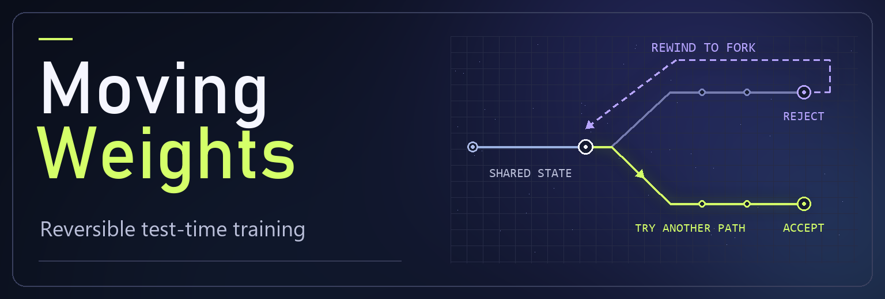
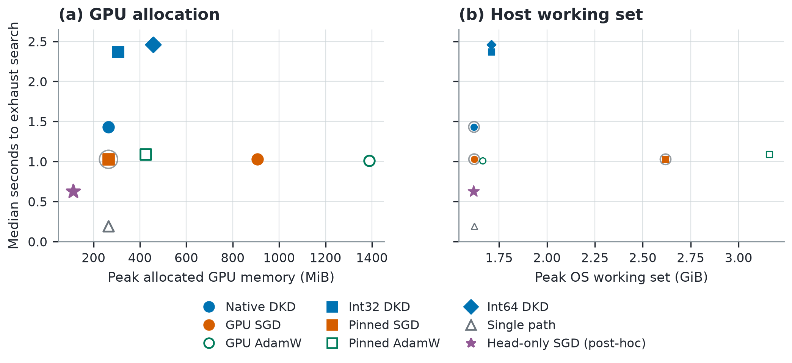

<a href="paper/main.pdf">
  
</a>

<h1 align="center">When Does Reversible Test-Time Training Pay Off?</h1>

<p align="center">
  <strong>Noel Bobby</strong><br>
  Bit-exact lattice replay, precision horizons, and checkpointing tradeoffs
</p>

<p align="center">
  <a href="paper/main.pdf"><strong>Read the paper</strong></a> &nbsp;·&nbsp;
  <a href="paper/manuscript-source-polished.zip">Download the LaTeX source</a> &nbsp;·&nbsp;
  <a href="#reproduce-the-paper">Reproduce the paper</a>
</p>

A test-time update can change a model before feedback tells you whether it helped. This project tests when it pays to reconstruct the previous parameters and optimizer state from an ordered batch tape. The experiments move from a double well and a small MLP to a **10,517,504-parameter Transformer** with speculative search.

## What the experiments found

| Question | Result |
| :--- | :--- |
| **Can the model rewind exactly?** | Int32 and int64 each recovered **195/195** checked Transformer tree parents bit for bit. The long-tape claim failed. The range guards stopped int32 at step **284** and int64 at **278**, and rounding had already erased nonzero kicks. [Precision results](paper/sections/search.tex) |
| **Does rewind help when feedback is delayed?** | The terminal-feedback recovery test passed against terminal-only AdamW skip. An exploratory early-skip policy on the same seeds closed nearly all of the accuracy gap. The Fisher-based interventions failed their pre-specified retention criteria. [Adaptation results](paper/sections/adaptation.tex) |
| **Does branching pay for the extra work?** | At depth eight, depth-first search solved **27/27** exact-prior model-rule pairs, versus **3/27** for one path. Int32 used **305.8 MiB** of peak GPU allocation versus **906.6 MiB** for resident momentum SGD checkpoints. At the same solve rate, pinned-host SGD exhausted the tree **2.31×** faster than int32. [Coverage](paper/tables/branching.tex) · [Systems results](paper/tables/systems.tex) |

<p align="center">
  <a href="paper/figures/fig3_systems_pareto.pdf">
    
  </a>
</p>

<p align="center"><sub>Measured depth-eight search. Exhaustive runtime is plotted against peak GPU allocation and peak host working set. The star marks an exploratory head-only control.</sub></p>

## Reproduce the paper

The tables and figures rebuild from **58 SHA-256-pinned inputs** in the archived Git history. This build needs Git, Python with Matplotlib, and a TeX toolchain. It needs no GPU. [Evidence manifest](paper/scripts/source_pins.json) · [Verified build receipt](paper/verification/polished-build.json)

<details>
<summary><strong>Build from a fresh clone</strong></summary>

```bash
git clone https://github.com/nbobby07/moving-weights.git
cd moving-weights
python -m pip install matplotlib

scratch="$(mktemp -d)"
python -B paper/scripts/restore_evidence.py --output "$scratch/evidence"
export MTTT_EVIDENCE_ROOT="$scratch/evidence"

python -B paper/scripts/build_tables.py
python -B paper/scripts/build_figures.py
export SOURCE_DATE_EPOCH="$(git show -s --format=%ct 834128d)"
(cd paper && tectonic --keep-logs main.tex)
```

[PowerShell instructions and historical controls](paper/README.md)

</details>

## Explore the repository

| Where | What to look for |
| :--- | :--- |
| [`paper/`](paper/) | Manuscript, figure PDFs, generated tables, and build receipts |
| [`src/mttt/`](src/mttt/) | Reversible optimizers, integer lattice updates, and baseline adapters |
| [`eval/`](eval/) · [`eval_v2/`](eval_v2/) · [`eval_v3/`](eval_v3/) | Fixed benchmark protocols for the three research phases |
| [`artifacts/`](artifacts/) · [`theory/evidence/`](theory/evidence/) | Raw experiment outputs, validation locks, and independent audits |
