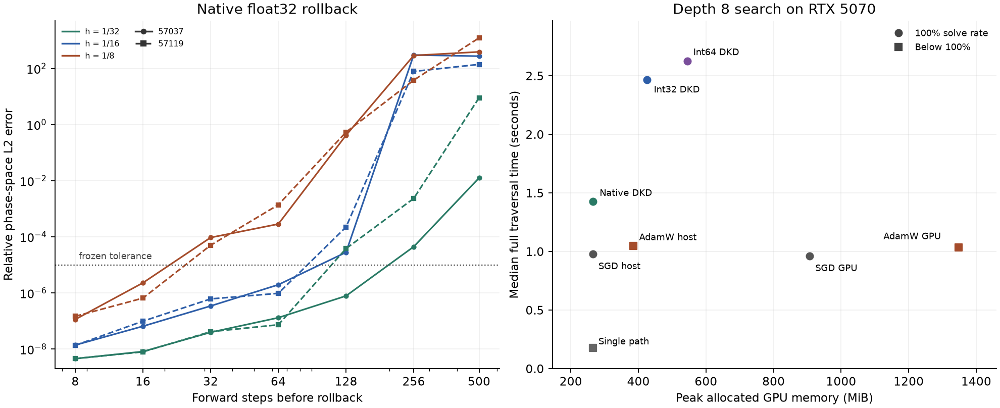

# Phase 3 | Reference results

**P3-A failed as a joint claim. P3-B and P3-C passed their frozen criteria.** Both lattice formats restored every audited tree parent byte for byte and matched native task accuracy. The long changing-batch tape exhausted both configured numerical ranges before step 500. Reversible search saved device memory against GPU checkpoints at depths 4 and 8. Pinned-host SGD was faster and used less device memory than either lattice format. [Compact audit JSON](evidence/phase3/reference_audit.json) · [Full test manifest and decisions](evidence/phase3/test.json)

## Numerical findings

The four-block, 10,517,504-parameter Transformer ran on an NVIDIA GeForce RTX 5070 using PyTorch 2.14.0+cu130. Repeated CUDA forces at the same midpoint had identical bytes. Full-size CPU and CUDA directional finite differences also passed the 1% tangent-map check. The CPU traversal smoke and 625 exhaustive small integer inverse cases passed. [CPU controls](evidence/phase3/smoke.json) · [SymPy and finite-arithmetic controls](evidence/phase3/symbols.json)

| Public seed | Step size | First sampled relative error ≥ 1e−5 | Directional rate at T=500 | Exponential fit R² | Power-law fit R² |
|---:|---:|---:|---:|---:|---:|
| 57037 | 1/32 | 256 | 0.713 | 0.978 | 0.879 |
| 57037 | 1/16 | 128 | 2.776 | 0.935 | 0.987 |
| 57037 | 1/8 | 32 | 3.525 | 0.798 | 0.962 |
| 57119 | 1/32 | 128 | 2.286 | 0.958 | 0.863 |
| 57119 | 1/16 | 128 | 9.219 | 0.945 | 0.893 |
| 57119 | 1/8 | 32 | 1.011 | 0.951 | 0.970 |

Larger steps brought earlier tolerance misses. At 1/8 the power-law fit was better on both seeds over the four eligible, unsaturated samples. The experiment measured substantial amplification, but failed to confirm the registered exponential scaling law. Under a separately justified uniform per-step Lipschitz bound L > 1 and local error δ, the finite product bound in the spec reduces to δ(Lᵐ − 1)/(L − 1) over m steps. The measured directional rate cannot substitute for that uniform bound. [All local stretches and rollback errors](evidence/phase3/test_parts/physics.json)

Each integer format recovered **195/195 parent states**, including 132/132 at depth 8. Native f32 recovered 0/195 bitwise, with maximum tree parent weight L2 error 1.45e−6. All three formats scored 100% on the assigned rule's challenge tokens at every held-out depth and seed. Native and int32 phase state each occupied 84,140,032 bytes. Int64 occupied 168,280,064 bytes. AdamW's dense state occupied 126,210,056 bytes including the counter.

| Format | Position / momentum shifts | First rejected forward shear at h=1/16 | Last prefix tested separately |
|---|---|---|---|
| Int32 | 26 / 28 | Step 284, first drift, coordinate 3,073,333. Attempted 2,154,166,234 against limit 2,147,483,647. | 283 steps, both L2 errors exactly 0 |
| Int64 | 44 / 44 | Step 278, second drift, coordinate 21,735. Attempted 1,128,991,126,730,588 against the conservative binary64-intermediate limit 1,125,899,906,842,623. | 277 steps, both L2 errors exactly 0 |

The last-prefix checks were run after the frozen test, using unchanged settings. At D=8, 0.965% of nonzero int32 shear components rounded to zero across the audited paths. On the first seed this occurred in the first kick at coordinate 9,085 with an increment of 0.202 lattice units. No complete nonzero tree shear was lost. Int64's long-run failure was a software range guard, not exhaustion of all 64 hardware bits. [Boundary checks](evidence/phase3/last_safe_prefix.json) · [Int32 tree diagnostics](evidence/phase3/test_parts/int32_8.json)

## Branching utility

| Depth | Exact-prior solve, int32 DFS | Exact-prior solve, single path | Sampled solve, single path | Highest gated detector AUC | Visit-rank-only AUC after previous failures |
|---:|---:|---:|---:|---:|---:|
| 1 | 100.0% | 50.0% | 50.0% | 0.554 | 0.750 |
| 2 | 100.0% | 33.3% | 33.9% | 0.513 | 0.719 |
| 4 | 100.0% | 20.0% | 18.2% | 0.547 | 0.712 |
| 8 | 100.0% | 11.1% | 12.0% | 0.536 | 0.683 |

All three DKD formats solved every admissible secret on all three public models. Every measured edge curve in both outcome classes met the registered smooth-decrease criterion. The largest gated AUC was 0.554. Visit rank carries legitimate information once earlier candidates have failed. The clean-signal comparison conditions on that history. This is evidence for this detector bank on a deliberately symmetric, model-only verifier task. The gain also uses more terminal submissions; the experiment does not establish that gradient search is necessary when direct symbolic proposals are allowed.

## Systems audit

Each cell below lists **peak allocated GPU MiB / OS peak host working set GiB / median seconds to exhaust the tree**. The OS peak includes setup. All metrics are measured on the same three seeds per cell in separate method/depth processes. The raw workers also give peak GPU reservations, scoped RSS, transfer bytes and setup-inclusive elapsed time.

| Method | Depth 1 | Depth 2 | Depth 4 | Depth 8 |
|---|---:|---:|---:|---:|
| Native DKD | 264.6 / 1.62 / 0.063 | 264.6 / 1.62 / 0.176 | 264.6 / 1.62 / 0.441 | 264.7 / 1.62 / 1.426 |
| Int32 DKD | 425.1 / 1.74 / 0.104 | 425.1 / 1.74 / 0.252 | 425.1 / 1.74 / 0.759 | 425.2 / 1.74 / 2.467 |
| Int64 DKD | 545.2 / 1.74 / 0.128 | 545.2 / 1.74 / 0.268 | 545.2 / 1.74 / 0.774 | 545.3 / 1.74 / 2.627 |
| Momentum SGD, GPU | 344.9 / 1.62 / 0.051 | 425.1 / 1.62 / 0.118 | 585.6 / 1.62 / 0.319 | 906.6 / 1.62 / 0.962 |
| AdamW, GPU | 505.3 / 1.66 / 0.052 | 625.7 / 1.66 / 0.122 | 866.5 / 1.66 / 0.330 | 1347.9 / 1.66 / 1.036 |
| Momentum SGD, pinned host | 264.6 / 1.75 / 0.056 | 264.6 / 1.87 / 0.125 | 264.6 / 2.12 / 0.330 | 264.7 / 2.62 / 0.978 |
| AdamW, pinned host | 385.0 / 1.85 / 0.061 | 385.0 / 2.04 / 0.138 | 385.0 / 2.41 / 0.401 | 385.0 / 3.16 / 1.047 |
| Single path | 264.6 / 1.62 / 0.027 | 264.6 / 1.62 / 0.047 | 264.6 / 1.62 / 0.090 | 264.7 / 1.62 / 0.177 |

At D=8 int32 saved **481.5 MiB** versus GPU-checkpoint SGD. Its peak ID payload was **128 bytes**, backed by a reproducible 12,288-byte support/probe corpus. The f32 weights alone would occupy 42,070,016 bytes. Device savings against GPU SGD first appeared at D=2 by just 512 bytes; D=4 was the first material saving, 160.5 MiB. Int64 first beat GPU SGD at D=4. Against GPU AdamW the first measured wins were D=1 for int32 and D=2 for int64.

At D=8 pinned-host SGD achieved the same 100% solve rate in 0.978 s and 264.7 MiB GPU memory, against 2.467 s and 425.2 MiB for int32. Its peak host working set was 2.62 GiB versus 1.74 GiB for int32. Pinned-host AdamW solved 92.6% under the exact prior at this depth. Native DKD used 88 forward plus 72 reverse gradients in the exhaustive D=8 traversal. Checkpoint baselines used 88 forward gradients, and the single-path control used 16.

**Forward and transfer crossovers.** The median paired forward step ratios to momentum SGD were 0.988× native, 1.894× int32 and 2.056× int64. Each used one gradient. Median preallocated pinned round trips were 2.99 ms for a full SGD state and 4.48 ms for AdamW. At K=1, native, int32 and int64 rewinds took 8.94, 14.85 and 14.08 ms respectively. The time crossover was already reached at the first measured K for every peer, even when charging both transfer directions. [All timer repeats and K=1,2,4,8 measurements](evidence/phase3/test_parts/physics.json)

The empirical unit is the public model/data seed. There were three, on one GPU, with short procedural sequences and a shared grid initialization. Production-scale pretraining, arbitrary pretrained f32 checkpoint conversion and unrestricted early-skip strategies were outside this run. [Frozen spec](phase3_math_spec.md) · [Independent reduction code](phase3_reference_audit.py)
